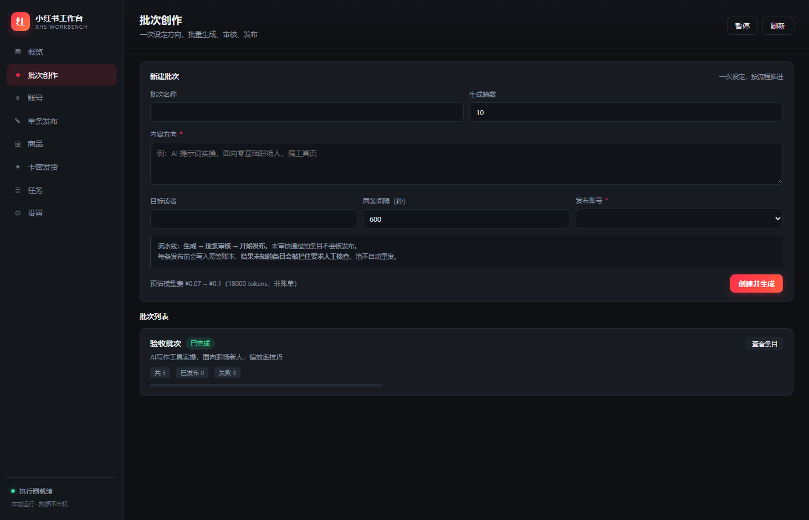
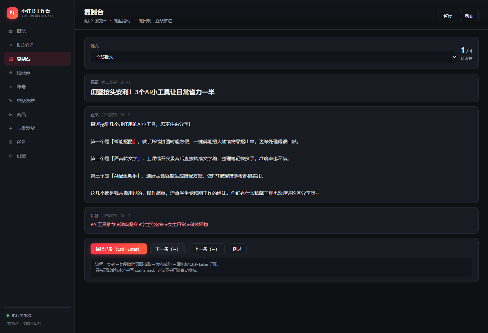

# 小红书工作台

本地运行的小红书内容工作台：**输入一个方向，批量生成笔记 → 逐条审核 → 发布。**
带幂等账本，同一条内容不会被发两次。

> **开源范围**：前端与技能包 MIT 开源；后端内核以编译产物分发（闭源）。
> 这不是一个「完整开源软件」，是「开源前端 + 闭源内核」的混合分发，详见下方说明。



## 能做什么

- **批量创作**：填一个内容方向，一次生成 N 篇笔记草稿（标题 / 正文 / 话题）
- **逐条审核**：模型产出一律先落「待审核」，你点通过才进入发布队列
- **防重复发布**：每条发布前写入幂等账本，结果未知的条目会被拦住要求人工核查
- **四种发布方式**：内置浏览器自动化 / 导出待发包（配闭源插件）/ 批量导入表（配分发工具）/ HTTP Webhook
- **虚拟商品**：卡密库、按 SKU 匹配订单、生成发货清单
- **11 个写作技能**：标题公式、真实种草体、干货教程、情绪共鸣、去 AI 味、合规自查等



## 不能做什么

- 不做「一键全自动涨粉」
- 不保存账号密码（登录靠扫码，会话存在本地浏览器档案）
- 不上传任何数据到服务器
- 不保证不被平台风控（见文末风险声明）

## 仓库结构

```
.
├── web/                 前端（MIT 开源，纯静态，无构建步骤）
├── skills_builtin/      11 个写作技能包（MIT 开源）
├── launcher.py          启动器（MIT 开源）
├── releases/            内核放这里（不提交到 git）
├── SHA256SUMS.txt       内核校验值
├── LICENSE              开源部分：MIT
├── LICENSE-CORE         内核部分：闭源
└── NOTICE.md            第三方组件与致谢
```

## 快速开始

1. 到 [Releases](../../releases) 下载最新的 `app-x.y.z.zip`，放进 `releases/` 目录
2. `pip install flask requests`
3. 双击 `启动工作台.vbs`，浏览器打开 `http://127.0.0.1:8788`

详细步骤与排错见 [INSTALL.md](./INSTALL.md)。

**环境要求**：Windows 10/11 + **Python 3.11**（内核是字节码，与 Python 次版本绑定）。

## 为什么内核闭源

前端跑在浏览器里，本来就无法隐藏，索性完全开源——方便改样式、加页面、提 PR。

内核包含发布调度、幂等账本、适配器路由、技能注入等逻辑，是作者的主要工作量，
以编译产物（`.pyc` + zipimport）分发。

如果你需要完全开源的实现，可以只读 `web/` 和 `skills_builtin/`，
按 [INSTALL.md](./INSTALL.md) 里的接口约定自己实现后端——前端调用的所有接口都是明面上的。

## 参与贡献

- 改界面、改文案、加技能包、修文档：直接提 PR，这些都在 MIT 范围内
- 想加新技能：照 `skills_builtin/<id>/SKILL.md` 的格式写，frontmatter + 提示词正文
- 内核相关问题：提 Issue 描述现象即可，不要求你提供源码

## 许可证

| 范围 | 许可证 |
|---|---|
| `web/`、`skills_builtin/`、`launcher.py`、文档 | **MIT** → [LICENSE](./LICENSE) |
| `releases/app-*.zip` | **闭源** → [LICENSE-CORE](./LICENSE-CORE) |

第三方组件与技能出处见 [NOTICE.md](./NOTICE.md)。其中
[Humanizer-zh](https://github.com/op7418/Humanizer-zh) 与
[renhua](https://github.com/jack-reson8/renhua) 为 MIT 许可的原文收录，版权归原作者。

## 风险声明

本工具通过浏览器自动化操作第三方平台，**可能违反其用户协议**，可能导致内容限流、
账号受限或封禁。请先用小号验证，不要在主账号上直接使用。

本项目不提供任何形式的担保，使用后果由使用者自行承担。
